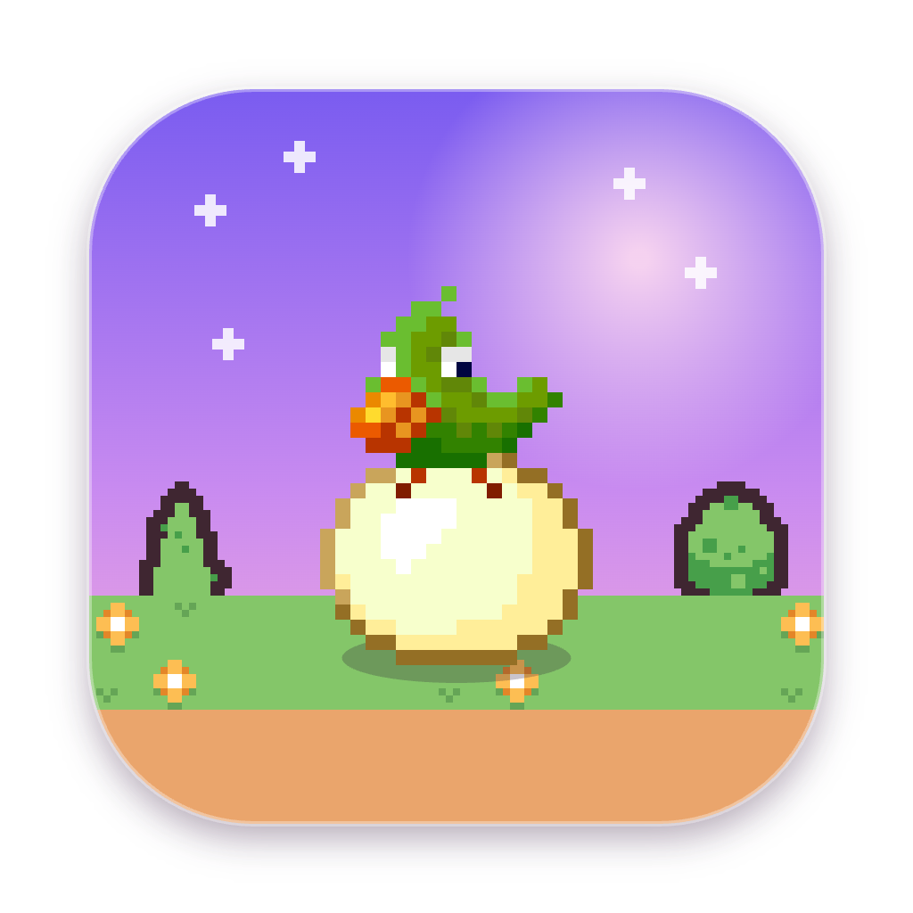
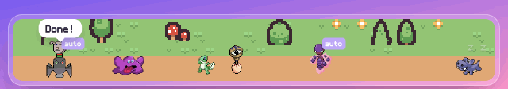
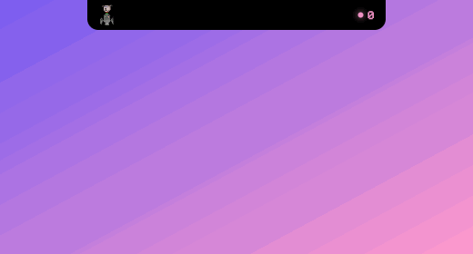
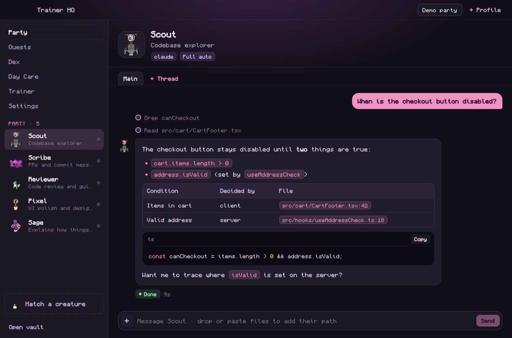
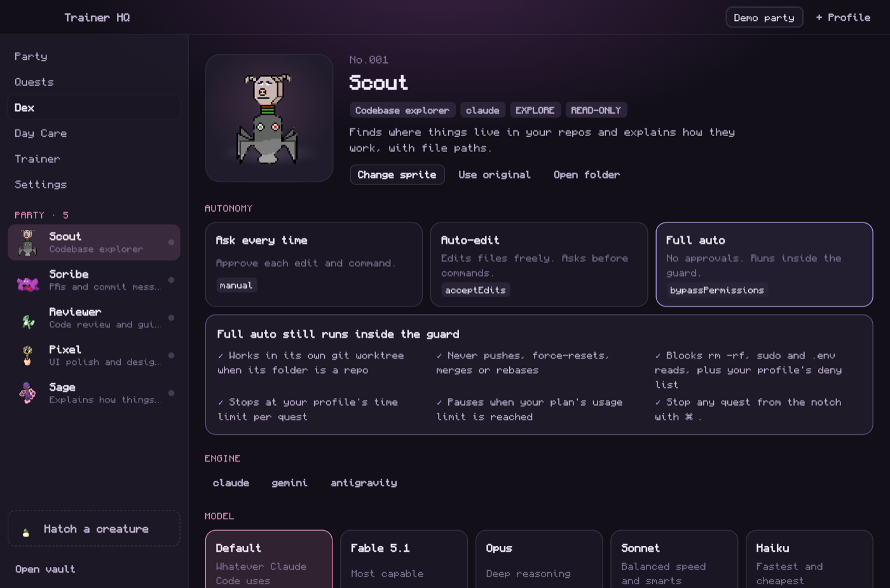
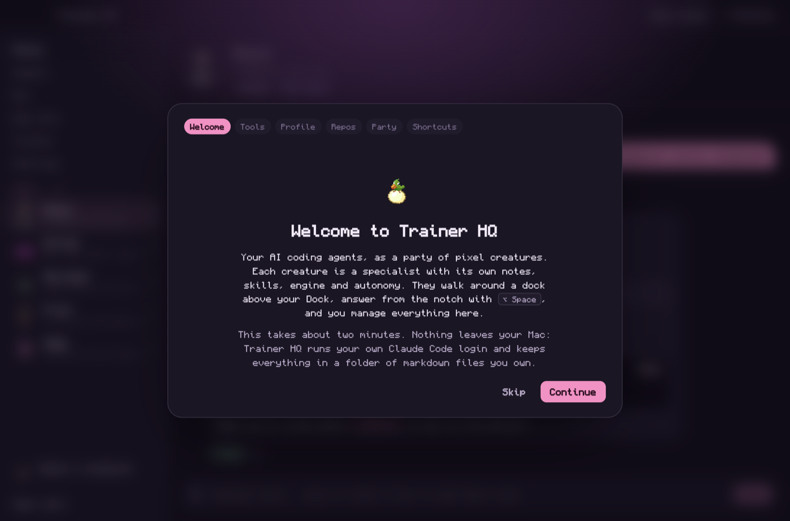

<div align="center">



# Trainer HQ

**Your AI coding agents, as a party of pixel creatures.**
They walk around a little route above your Dock, answer from the notch, call each other for help, and remember what they learn.



[Install](#install) · [Tour](#a-quick-tour) · [Make it Pokémon](#make-it-pokémon-for-your-own-setup) · [Configure](#configuration) · [Contribute](CONTRIBUTING.md)

</div>

---

## Why

You probably have several Claude Code sessions open, a pile of `CLAUDE.md` files, and the same context pasted into every chat. Trainer HQ turns that into a **party**:

- 🥚 Each **creature** is a specialist (your data expert, your reviewer, your backend person) with its own notes, skills, engine and level of autonomy.
- 🧠 Their **brain** is a folder of markdown (an Obsidian-friendly vault) that you own. It grows as they work, through **Day Care**, after you approve each note.
- 🗺️ They live on a **route dock** above the macOS Dock and in the **notch**, so asking one is a keypress away: <kbd>⌥ Space</kbd>.
- 🤝 They **ask each other**: your reviewer can ask your data creature for numbers without you copy-pasting.
- 🔒 It runs **your own `claude` CLI login**. No API keys, and nothing leaves your Mac beyond what Claude Code already sends.

## A quick tour

### The notch

Hover the notch, or press <kbd>⌥ Space</kbd>, pick a creature (<kbd>⇥</kbd> switches), type, and hit Enter. Approvals pop up right there.



### The party

Every creature has a chat with Markdown, code blocks and tables, plus **threads** for separate contexts (a branch or a PR in its own git worktree).



### The Dex

See what a creature knows, change its sprite, and choose its autonomy: **ask every time**, **auto-edit**, or **full auto** inside a guard that never pushes, merges or resets.



### First run

A short onboarding checks your tools, sets up your vault and repos, and introduces the starter party.



## Features

| | |
|---|---|
| **Creatures** | Specialists defined by a `creature.yaml` and a `brain/` folder. Five original starters: Scout, Scribe, Reviewer, Pixel and Sage. |
| **Hatching** | Describe a new creature in plain words; it researches your repos read-only and writes its own folder. |
| **Threads** | Several contexts per creature, each its own Claude session; point one at a branch or PR and it works in an isolated worktree. |
| **Handoffs** | `ask_creature`: creatures call teammates and get answers back, with chain limits and timeouts. |
| **Autonomy + guard** | Ask / auto-edit / full auto. Full auto keeps a deny list, a time limit and worktrees, and pauses near your plan's usage limit. |
| **Day Care** | After each chat, suggested notes wait for your approval before they reach the brain. |
| **Engines** | Claude Code by default; any CLI agent (Gemini CLI, Antigravity, …) through a generic adapter. |
| **Attachments** | Drop or paste files: their paths go into the message, zips are unpacked, and skill zips install in one click. |
| **Profiles** | One vault per profile (work, personal…), each optionally with its own Claude account. |
| **Lab** *(optional)* | Plug in a render-harness skill to screenshot your app's real screens and hand them to a design-audit creature. |

## Install

You need **macOS 13+**, **Node 20+**, and [**Claude Code**](https://docs.claude.com/en/docs/claude-code) installed and signed in (`claude auth login`).

```bash
git clone https://github.com/mohamedwael3011/trainer-hq.git
cd trainer-hq
npm install
npm run install:app      # builds, signs ad hoc, copies to /Applications and opens it
```

Then launch **Trainer HQ** from Spotlight. Onboarding takes about two minutes; turn on **Launch at login** at the end so the dock and notch are always there.

<details>
<summary>Other ways to run it</summary>

- `npm run dev`: hot-reloading development build.
- `npm run package:mac`: builds `dist/mac-arm64/Trainer HQ.app` without installing.
- `npm run dist:mac`: builds a `.dmg`. Downloaded copies are quarantined by macOS; clear that with `xattr -dr com.apple.quarantine "/Applications/Trainer HQ.app"`.
- `npm run smoke`: builds, launches, saves a PNG of every window to `out/smoke/`, and quits.

</details>

## Make it Pokémon (for your own setup)

Trainer HQ ships with **original** creatures (from the open-source [Tuxemon](https://wiki.tuxemon.org/) project) so the repo stays free to share. It's built so your **private** setup can look like any creature collector you like, Pokémon included. Everything below lives in your own vault, never in this repo.

**1. Give creatures Pokémon names.** Edit `name:` in each creature's `creature.yaml`. Keep the `id:` as it is so sessions, sprites and `@mentions` keep working (both `@scout` and `@porygon` reach it).

```yaml
id: scout
name: Porygon
role: Codebase explorer
```

**2. Drop in sprites.** Put an image named after the creature's **id** in `<vault>/sprites/overrides/`, or use **Dex → Change sprite**. PNG, WebP and **animated GIF** all work, and GIFs animate in the dock and notch.

```
my-vault/sprites/overrides/
├─ scout.gif      # shows for the creature with id: scout
├─ reviewer.png
├─ dozer.gif      # the sleeper that naps when nothing is running
└─ egg.png        # the Hatch button and onboarding egg
```

**3. Cast your party.** Some pairings that fit the roles:

| Role | Starter | Pokémon-style pick | Why it fits |
|---|---|---|---|
| Codebase explorer | Scout | Porygon | lives inside computers |
| Code reviewer | Reviewer | Rotom | possesses machines, catches bugs |
| Design audits | Pixel | Smeargle | paints, cares about every pixel |
| Explains how things work | Sage | Alakazam | an IQ of 5000 |
| PRs in your voice | Scribe | Ditto | transforms into whatever you write like |
| Squad memory | *(hatch one)* | Noctowl | owls never forget |
| Backend guard | *(hatch one)* | Steelix | iron-hard foundations |
| Idle sleeper | Dozer | Snorlax | naps when nothing is running |

**4. Get sprites from Pokémon Showdown.** [Pokémon Showdown](https://play.pokemonshowdown.com/) serves pixel sprites by lowercase name, and the gen 5 ones match Trainer HQ's look best:

| Kind | URL pattern | Example |
|---|---|---|
| Animated GIF (best) | `https://play.pokemonshowdown.com/sprites/gen5ani/<name>.gif` | `.../gen5ani/porygon.gif` |
| Still PNG (fallback) | `https://play.pokemonshowdown.com/sprites/gen5/<name>.png` | `.../gen5/porygon.png` |

Names are lowercase with punctuation removed (`mr. mime` → `mrmime`, `farfetch'd` → `farfetchd`); forms add a suffix such as `rotom-wash`. Save each file as `<creature-id>.gif` (or `.png`) in your vault's `sprites/overrides/`. Trainer HQ picks it up immediately, and an override always wins over the creature's `sprite:` line, so leave that line as it is.

```bash
cd ~/Documents/my-vault/sprites/overrides
curl -fLo scout.gif https://play.pokemonshowdown.com/sprites/gen5ani/porygon.gif
curl -fLo dozer.gif https://play.pokemonshowdown.com/sprites/gen5ani/snorlax.gif
```

**5. Or let Claude do it.** Paste this into Claude Code (or a Trainer HQ creature with write access to your vault), replacing the vault path and the cast:

```text
Turn my Trainer HQ party into Pokémon. My vault is ~/Documents/my-vault.

Cast (creature id → Pokémon):
- scout → Porygon
- reviewer → Rotom
- pixel → Smeargle
- sage → Alakazam
- scribe → Ditto
- dozer → Snorlax (the idle sleeper, no creature.yaml)

For each one:
1. If party/<id>/creature.yaml exists, change only its name: line to the Pokémon's name. Keep id, role, tools and everything else exactly as they are.
2. Download its Pokémon Showdown sprite into sprites/overrides/<id>.gif from
   https://play.pokemonshowdown.com/sprites/gen5ani/<lowercase-name>.gif
   If that 404s, download https://play.pokemonshowdown.com/sprites/gen5/<lowercase-name>.png as <id>.png instead.
   Lowercase the name and strip punctuation (mr. mime → mrmime).
3. Check each file is a real image (not an HTML error page) and delete it if not.

Don't touch any file outside party/*/creature.yaml and sprites/overrides/.
Finish with a table of creature id, new name, sprite file and size.
```

Hatch new creatures later with a Pokémon name in mind ("a squad-memory creature called Noctowl") and run step 2 for them.

**6. Keep it private.** Pokémon names and sprites belong to Nintendo, Game Freak and The Pokémon Company. Use art you're allowed to use, keep it in your own vault for personal use, and **don't commit it to this repo or share builds that include it**. PRs that add copyrighted art will be closed; freely licensed creature art is very welcome (see [CONTRIBUTING.md](CONTRIBUTING.md)).

## Concepts

<details open>
<summary><b>The vault</b></summary>

```
my-vault/
├─ profile.yaml            repos, engines, guard, day care, env, lab
├─ shared/                 notes any creature can reference
├─ party/
│  └─ scout/
│     ├─ creature.yaml     who it is and what it may do
│     ├─ brain/*.md        what it knows (loaded into its system prompt)
│     └─ skills/<name>/SKILL.md   optional local skills
├─ daycare/inbox/          suggested notes waiting for your approval
└─ sprites/overrides/      your own sprites, named <creature-id>.png|gif|webp
```

Open it in Obsidian (**Open folder as vault**) to browse and edit the brain. Edits apply on the next message.
</details>

<details>
<summary><b>Autonomy and the guard</b></summary>

| Level | Claude permission mode | What happens |
|---|---|---|
| Ask every time | `manual` | Every edit and command shows up as an approval (notch, chat, Quests) |
| Auto-edit | `acceptEdits` | File edits go through; commands still ask |
| Full auto | `bypassPermissions` | No approvals, inside the guard |

The guard always applies: a built-in deny list (`git push`, `git reset --hard`, `git clean`, `git merge`, `git rebase`, `rm -rf`, `sudo`, `.env` reads) plus your own rules. Full-auto quests run in their own git worktree, stop after a time limit, and won't start when your 5-hour plan usage is above a threshold. A quest that hits your plan limit is **Paused**, not failed. <kbd>⌘ .</kbd> in the notch stops the latest quest.

Approvals are answered by a tiny MCP server (`resources/mcp/permission-server.cjs`) that Claude calls through `--permission-prompt-tool`, over `127.0.0.1` with a random per-launch token.
</details>

<details>
<summary><b>Threads</b></summary>

Each creature has a **Main** thread and as many extra threads as you like (**+ Thread** above the chat). A thread is its own Claude session, like another terminal running `claude`. Point it at a repo branch or a PR (resolved with `gh`) and, with **isolated worktree** on, Trainer HQ runs `git worktree add` into `~/.trainer-hq/worktrees/` so your checkout is untouched. **Archive + remove worktree** cleans up.
</details>

<details>
<summary><b>Handoffs between creatures</b></summary>

Every creature gets an `ask_creature` tool and a roster of teammates. When a question is outside its role, it asks the right teammate: Trainer HQ runs a linked quest with that creature's own notes, tools and autonomy, and returns the answer. The asking chat shows a live handoff card; the dock shows "Asking …" and "On it for …". Chains stop at two levels and time out after 10 minutes.
</details>

<details>
<summary><b>Hatching and Day Care</b></summary>

**Hatch** runs a Claude session in the vault with read access to the repos you pick and a strict brief: pick a name, research the repos read-only, write `brain/` notes, optional skills and `creature.yaml`. The creature appears as soon as its file lands.

**Day Care** reads each finished chat and proposes durable notes (gotchas, contracts, decisions). Nothing reaches a brain until you click **Teach it**, unless you opt a full-auto creature out of review.
</details>

<details>
<summary><b>The Lab (optional)</b></summary>

The Lab tab drives a *render harness* skill: a tool that renders your app's real screens in headless Chrome from scenario JSON and screenshots them across devices, languages and themes. Point Trainer HQ at it in **Settings → Lab** (or a `lab:` block in `profile.yaml`), then build workspaces, start the dev server, shoot flows, browse renders, and send any shot to your design-audit creature. Without a `lab:` block, the tab is hidden.
</details>

## Configuration

Everything is editable in **Settings**, which writes your vault's `profile.yaml` (comments and formatting are kept). For reference:

<details>
<summary><code>profile.yaml</code></summary>

```yaml
name: My Party
claudeConfigDir: ~/.claude-personal   # optional: only for a second Claude account
spriteOverrides: sprites/overrides

repos:
  my-app: ~/code/my-app

engines:
  claude:
    adapter: claude
    bin: claude
  gemini:
    adapter: cli
    bin: gemini
    args: ["-p", "{prompt}"]          # {prompt} and {system} are substituted; without {prompt} the prompt goes to stdin

guard:
  fullAuto:
    maxMinutes: 45
    maxPlanUsage: 0.85
    worktree: true
  alwaysDeny:
    - "Bash(gh pr merge:*)"

daycare:
  mode: free                          # free: creatures list notes themselves · ai: extra Haiku pass · off
  autoApproveFullAuto: false

env:                                  # extra environment variables for every creature
  MY_APP_DIR: ~/code/my-app

lab:                                  # optional, see "The Lab"
  title: My app
  home: ~/render-workspaces
  skill: ~/.claude/skills/my-render-harness
  examples: examples
  markerFile: .render-commit
  serverScript: app/harness/bin/restart_server.sh
  port: 8787
  clock: { now: "2026-01-01T10:00:00Z", tz: UTC }
```
</details>

<details>
<summary><code>creature.yaml</code></summary>

```yaml
id: scout
no: 1
name: Scout
role: Codebase explorer
blurb: Finds where things live and explains how they work, with file paths.
types: [EXPLORE, READ-ONLY]
sprite: builtin:pigabyte            # or a path relative to the creature folder
engine: claude                      # any key under engines:
model: claude-sonnet-5-5            # optional
autonomy: ask                       # ask | auto-edit | full-auto
cwd: ~/code/my-app
addDirs: [~/code/other-repo]
brain: ["brain/*.md", "../../shared/*.md"]
skills: [review]
tools:                              # Claude Code permission rule syntax
  allow: [Read, Grep, Glob, "Bash(git log:*)"]
  ask: ["Bash(git commit:*)"]
  deny: [Write]
learns:
  into: brain/
  review: true
```

Built-in sprites: `pigabyte`, `flacono`, `anoleaf`, `grintrock`, `tweesher`, `cairfrey`, `eyenemy`, `hampotamos`, `sampsage`, `hatchling`.
</details>

<details>
<summary>Profiles (work and personal)</summary>

Each profile is one vault. Switch from the title bar; create one with **+ Profile**. Profiles are listed in `~/.trainer-hq/profiles.yaml`. Set `THQ_HOME` to keep Trainer HQ's own state somewhere else (handy for demos and tests).
</details>

## Shortcuts

| Keys | Does |
|---|---|
| <kbd>⌥ Space</kbd> | Open or close the notch |
| <kbd>⇥</kbd> / <kbd>⇧ ⇥</kbd> | Switch creature in the notch |
| <kbd>⌘ .</kbd> | Stop the latest quest (notch) |
| <kbd>⌥ ⇧ Space</kbd> | Minimize, restore or bring back the route dock |
| <kbd>⌥ ↑</kbd> / <kbd>⌥ ↓</kbd> | Reorder the selected creature |

## Troubleshooting

| Problem | Fix |
|---|---|
| Quests fail with `spawn claude ENOENT` | Trainer HQ reads your login shell's `PATH`. Check `which claude` in a new terminal, then restart the app. |
| "Claude isn't signed in" | Click **Sign in** (it opens Terminal on `claude auth login`). Don't set `claudeConfigDir` to `~/.claude`: Claude then looks for a different login, so leave it empty for the default. |
| The notch isn't where the notch is | It's centered on the primary display; on external monitors it's a pill at the top. |
| A creature doesn't show up | The dashboard shows a red box naming the broken `creature.yaml`. |

## Architecture

```
src/
├─ shared/      constants, types and the preload API contract
├─ main/        Electron main: Hq orchestrator, engines, guard, approvals, threads, lab, vault registry, windows
├─ preload/     the window.hq bridge
└─ renderer/    React UI: Dock, Notch and Dashboard surfaces
```

Electron + React + TypeScript, built with electron-vite. `npm run typecheck` checks both sides.

## Credits

- Creature sprites: [Tuxemon Set 1](https://wiki.tuxemon.org/Set_1), CC BY-SA 4.0 (individual credits in [THIRD_PARTY_NOTICES.md](THIRD_PARTY_NOTICES.md)).
- Tiles: [Kenney Tiny Town](https://kenney.nl/assets/tiny-town), CC0.
- Typeface: [Monocraft](https://github.com/IdreesInc/Monocraft) by Idrees Hassan, SIL OFL 1.1.
- Motion principles: Emil Kowalski's design-engineering skills.

## License

Code: [MIT](LICENSE). Art and fonts keep their own licenses; see [THIRD_PARTY_NOTICES.md](THIRD_PARTY_NOTICES.md).
